# R26 Fedora Multi — trust boundaries for #307 Section A

Candidate: Epoch 5, `0.0.1rc6-26.fc46`, x86_64  
Classification: source review plus the existing R26 Fedora Multi runtime evidence; no product changes or new runtime test.

## Trust-boundary diagram

```mermaid
flowchart LR
  C[Customer browser] -->|HTTPS| CW[Caddy on Admin]
  CW -->|HTTPS over WireGuard| P[Portal: Harbor]
  P -->|Authenticated TLS over WireGuard| A[Admin: Admirald + PostgreSQL]
  A -->|Node-authenticated task claim; Ed25519-signed task| F[Fleet on Worker]
  F -->|runuser as admiral-apps| H[Rootless lifecycle/setup/backup helper]
  H -->|Podman + systemd --user| W[Per-instance Pod and services]
  CW -->|HTTPS route to published app endpoint| W
  W -->|service-local network| DB[Per-instance database and persistent volume]
```

Admin, Worker, and Portal are independent hosts in this topology. The Admin
system hosts the control plane and public Caddy ingress; Harbor runs as the
`admiral` account on the Portal. Fleet is a root system service on Worker and
delegates Podman operations to helpers running as the unprivileged
`admiral-apps` account. Workloads use rootless Podman and per-instance Quadlet
resources. Exact R26 installation and request-flow evidence is in
`R26-FEDORA-MULTI-REPORT.md`.

## Shared and per-instance resources

The Worker shares its kernel, physical resources, rootless account, Podman
installation, and that account's systemd user manager across customer pods.
This is a material shared-host boundary: compromise of the `admiral-apps` host
account would allow control of every workload managed by that rootless Podman
store, including its units, volumes, and secrets. Rootless operation limits
that account's authority relative to host root, but does not make compromise of
the account harmless.

R26 A/B runtime evidence shows distinct per-customer pod network, PID and user
namespace inodes, non-overlapping auto UID/GID maps, separate SELinux MCS labels,
separate database volume paths and service-scoped Podman secrets. The database
port was not published and the probe from A could not reach B's PostgreSQL
service. App and database services within one customer pod intentionally share
the pod's network namespace and user mapping; their processes have separate
PID namespaces. The snapshots and probes are covered by
`R26-FEDORA-MULTI-SHA256SUMS.txt`.

The container compromise boundary is therefore: a compromised service can
affect its own container and communicate with services reachable in its own
pod, and may access secrets and data intentionally mounted into that service.
The recorded R26 controls deny the tested cross-customer volume, secret-name,
runtime-socket and database-port paths. They do not prove resistance to a
kernel/Podman escape or protect other tenants after compromise of the shared
`admiral-apps` account, Fleet, or the control plane.

## Authorization boundary and remaining proof

Fleet authenticates to Admin as a node, claims only tasks assigned to that
authenticated node, rejects unsigned tasks, verifies the Ed25519 signature and
timestamp, and rejects a recently replayed task ID. The production Fleet
execution path uses rootless helpers. These controls establish the Admin-to-
Fleet trust boundary in source.

They do not establish that every customer-facing request is authorized for the
requested instance before a privileged operation is queued, nor that a customer
cannot cause a command inside an application container. The setup mechanism
intentionally runs an app definition's `setup_command` inside that same
workload container. The negative tenant-authorization probes and the exact
customer-to-task authorization path remain open in #307 Sections B and K;
this report does not mark those controls PASS.

## Section A dispositions

This review supports checking the component trust boundaries, service
identities, execution chain, shared resources, per-instance resources, and
compromise-impact assessment. It leaves the customer-command and
customer-operation authorization checks pending their API/tenant evidence.
